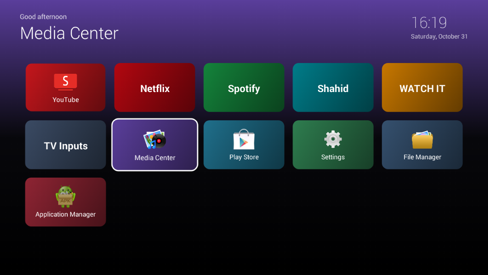

# KitKat TV Home

A small, offline Home screen for old MStar Android 4.4 smart TVs: colourful tiles with a glow that follows
the selected tile, with YouTube (through [SmartTube](https://github.com/yuliskov/SmartTube)) first.
Modern launchers need Android 8 or newer; this one runs on Android 4.4.



- About 20 KB, about 25 MB of RAM in use on a TV with 372 MB
- No network permission, no background services, no dependencies
- An idle clock after 3 minutes, which moves every minute to protect the panel
- Netflix, Spotify, Shahid and WATCH IT tiles for a streaming stick on HDMI: these apps do not run on
  Android 4.4, so the tiles explain that and offer the TV's input menu
- Factory and test apps are hidden on purpose: opening them can change a TV's factory state
- The stock launcher stays installed as a fallback

Tested on one TV: MStar `cv6a628h` board, Android 4.4.2, 1280x720. Other boards may differ, and the
TV Inputs tile only appears on MStar firmware. It opens the TV's own source menu, which may not list
every input (VGA was missing on the test TV).

## Build

Needs JDK 17 and Android SDK platform 34.

```bash
./gradlew assembleDebug
```

## Install

You need ADB access to the TV. On the test TV a plain `pm install` is not always possible from the
ADB shell, and the firmware's `su` was used instead, so check what your own TV allows.

```bash
adb install app/build/outputs/apk/debug/app-debug.apk
```

Press Home on the remote, choose **KitKat TV Home**, then **Always**.

## Undo

```bash
adb uninstall com.kitkattv.home
```

The stock launcher takes over again.

## Licence

MIT. See [LICENSE](LICENSE).
